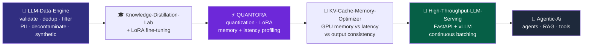
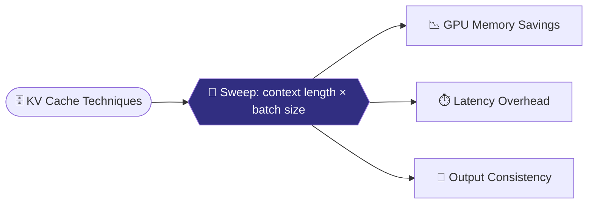
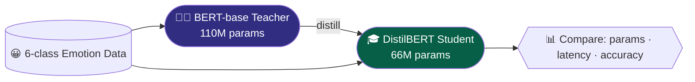

<div align="center">


<a href="https://github.com/Tanish-o9"></a>

<br/>

[](https://www.linkedin.com/in/tanish-kumar-61553b385/)
[](https://leetcode.com/u/Tanish_Kumar_123/)
[](mailto:tanishrajput673@gmail.com)


</div>

---

### ⚡ `boot.log`

```text
[ OK ] Loading profile ............ Tanish Kumar
[ OK ] Mounting education ......... B.Tech CSE @ AKGEC (AKTU) · CGPA 8.50
[ OK ] Starting community ......... Cloud Computing Cell (CCC), AKGEC
[ OK ] Syncing DSA ................ 130+ LeetCode problems solved
[ OK ] Cleaning data .............. dedup · PII detection · decontamination
[ OK ] Optimizing models .......... Quantization · LoRA · KV cache · Distillation
[ OK ] Serving at scale ........... FastAPI · vLLM · continuous batching
[ OK ] Spawning agents ............ LangChain · LangGraph · RAG · MCP
[ >> ] Status ..................... 🟢 OPEN TO AI ENGINEER INTERNSHIPS
```

---

### 👨‍💻 `whoami.py`

```python
from dataclasses import dataclass, field

@dataclass
class Tanish:
    role: str      = "AI Engineer (Intern-ready)"
    education: str = "B.Tech CSE @ AKGEC (AKTU) | CGPA 8.50"
    community: str = "Cloud Computing Cell (CCC), AKGEC"
    dsa: str       = "130+ LeetCode problems solved"
    focus: list    = field(default_factory=lambda: [
        "LLM Inference Optimization", "LLM Data Engineering",
        "Agentic AI", "RAG", "Multi-Agent Systems"
    ])
    mission: str   = "Make LLMs faster, smaller and cheaper, then build agents on top"
    status: str    = "🟢 Open to AI Engineer Internships"

    def ship(self, idea):
        return self.clean_data() | self.finetune() | self.optimize() | self.serve() | self.build_agents()

print(Tanish().status)   # >>> 🟢 Open to AI Engineer Internships
```

---

### 🧬 `pipeline.mmd`

Every pinned project below is one stage of the same idea: take an **LLM from raw data to a fast, cheap, production-ready service**.



---

### 📌 `gh repo list --pinned`

```bash
$ gh repo list Tanish-o9 --pinned
QUANTORA                      ⚡  LLM benchmarking + optimization platform
High-Throughput-LLM-Serving   🚀  FastAPI + vLLM serving stack, benchmarked 1-64 users
KV-Cache-Memory-Optimizer     🧠  KV cache memory vs latency vs consistency
LLM-Data-Engine               🧹  end-to-end LLM data pipeline + LoRA fine-tuning
Knowledge-Distillation-Lab    🎓  BERT-base (110M) -> DistilBERT (66M)
Agentic-Ai                    🤖  LangChain · LangGraph · RAG · tool-using agents
```

<div align="center">

<a href="https://github.com/Tanish-o9/QUANTORA"></a>
<a href="https://github.com/Tanish-o9/High-Throughput-LLM-Serving"></a>

<a href="https://github.com/Tanish-o9/KV-Cache-Memory-Optimizer"></a>
<a href="https://github.com/Tanish-o9/LLM-Data-Engine"></a>

<a href="https://github.com/Tanish-o9/Knowledge-Distillation-Lab"></a>
<a href="https://github.com/Tanish-o9/Agentic-Ai"></a>

</div>

#### 🔍 `inspect(projects)`

```python
projects = {
    "QUANTORA": {
        "idea":  "open-source LLM benchmarking and optimization platform",
        "how":   "measure, analyze and improve inference efficiency",
        "stack": ["quantization", "LoRA", "KV cache optimization",
                  "memory profiling", "latency analysis"],
        "lang":  "Python",
    },
    "High-Throughput-LLM-Serving": {
        "idea":  "FastAPI LLM serving stack",
        "bench": "naive Hugging Face baseline vs vLLM under 1-64 concurrent users",
        "uses":  ["FastAPI", "vLLM", "continuous batching", "PagedAttention"],
        "lang":  "Python",
    },
    "KV-Cache-Memory-Optimizer": {
        "idea":  "evaluate KV cache optimization techniques",
        "measures": ["GPU memory savings", "inference latency overhead",
                     "output consistency"],
        "sweep": "across context lengths and batch sizes",
        "lang":  "Python",
    },
    "LLM-Data-Engine": {
        "idea":  "end-to-end LLM data engineering pipeline",
        "has":   ["dataset validation", "deduplication", "quality filtering",
                  "PII detection", "data decontamination",
                  "synthetic data generation", "LoRA fine-tuning"],
        "lang":  "Python",
    },
    "Knowledge-Distillation-Lab": {
        "idea":  "distill BERT-base teacher (110M) into DistilBERT student (66M)",
        "task":  "6-class emotion classification",
        "lang":  "Python",
    },
    "Agentic-Ai": {
        "idea":  "collection of agentic AI projects",
        "stack": ["LangChain", "LangGraph", "LLMs", "RAG",
                  "vector DBs", "tool-using agents"],
        "lang":  "Python",
    },
}
```

<details>
<summary><b>🔬 Architecture peek: inside the projects</b> (click to expand)</summary>

<br/>

**🚀 High-Throughput-LLM-Serving**


**🧹 LLM-Data-Engine**


**🧠 KV-Cache-Memory-Optimizer**



**🎓 Knowledge-Distillation-Lab**



</details>

#### 🗂️ `also_built.py`

```python
also_built = {
    "LLM-Memory-Optimizer":        "FP16 / INT8 / INT4 profiling: VRAM, TPS, TTFT, WikiText-2 perplexity drift",
    "Lora-FineTuning-Lab":         "full fine-tuning vs LoRA on DistilBERT, rank + target-module ablations",
    "LangChain-with-LLM-Gateway":  "agents, tools, streaming, structured outputs, middleware, human-in-the-loop",
    "College-Times":               "AKGEC campus platform: real-time chat, news, events, gamification",
    "CineForge-AI":                "multi-agent AI film production platform",
    "Make-My-Trip":                "AI-first travel platform, LangGraph assistant, LLM router with failover",
    "Crash-Guard":                 "two-wheeler crash detection + emergency response",
    "Leetcode-Solution":           "DSA solutions, clean & efficient",
}
```

<div align="center">

[](https://github.com/Tanish-o9/LLM-Memory-Optimizer)
[](https://github.com/Tanish-o9/Lora-FineTuning-Lab)
[](https://github.com/Tanish-o9/LangChain-with-LLM-Gateway)
[](https://github.com/Tanish-o9/College-Times)
[](https://github.com/Tanish-o9/CineForge-AI)
[](https://github.com/Tanish-o9/Make-My-Trip)
[](https://github.com/Tanish-o9/Crash-Guard)
[](https://github.com/Tanish-o9/Leetcode-Solution)

</div>

---

### 🛠️ `stack.yaml`

<div align="center">


<br/>


</div>

```yaml
llm_inference:      [vLLM, PagedAttention, Continuous Batching, KV Cache Optimization, Quantization (FP16/INT8/INT4), Latency + Memory Profiling]
llm_data_eng:       [Dataset Validation, Deduplication, Quality Filtering, PII Detection, Decontamination, Synthetic Data]
model_training:     [LoRA, Knowledge Distillation, Fine-Tuning, Benchmarking]
agentic_ai:         [LangChain, LangGraph, Multi-Agent Systems, RAG, AI Memory, Tool Calling, MCP, LLM Orchestration, LLM Gateways]
ai_engineering:     [Python, LLMs, Prompt Engineering, AI Workflows, AI Applications]
ml_dl:              [Machine Learning, Deep Learning, NLP, Scikit-Learn, PyTorch, Computer Vision]
vector_search:      [FAISS, ChromaDB, RAG Search]
backend:            [FastAPI, Django, JWT]
database:           [PostgreSQL, MongoDB, Redis, Firebase]
frontend:           [HTML, CSS, JavaScript, React]
devops_cloud:       [Docker, GitHub Actions, n8n]
languages:          [Python, C, C++, JavaScript, TypeScript]
```

---

### 🎯 `roadmap.py`

```python
roadmap = {
    "Agentic AI & Multi-Agent Systems":   "████████░░ 80%",
    "LLM Orchestration & AI Memory":      "███████░░░ 70%",
    "RAG & Vector Search":                "███████░░░ 70%",
    "DSA (Arrays · Trees · Graphs · DP)": "██████░░░░ 60%",
}

for skill, progress in roadmap.items():
    print(f"{skill:<36} {progress}")
```

📚 **Daily practice** → [**LeetCode**](https://leetcode.com/u/Tanish_Kumar_123/) · [**DSA Repository**](https://github.com/Tanish-o9/Leetcode-Solution)

---

### 📊 `stats.log`

<div align="center">


<br/>


</div>

---

### 🤝 `contact.sh`

```bash
$ whoami
Tanish Kumar — AI Engineer (LLM Systems · Agentic AI · RAG)

$ cat looking_for.txt
AI Engineer internships: LLM inference and serving, data pipelines, agentic systems, RAG.

$ ./connect.sh
📫 Email     → tanishrajput673@gmail.com
💼 LinkedIn  → linkedin.com/in/tanish-kumar-61553b385
🧩 LeetCode  → leetcode.com/u/Tanish_Kumar_123
```

<div align="center">

```python
while True:
    clean(); finetune(); optimize(); serve(); ship()   # ⚡ Faster LLMs. Smarter Agents. Production-ready AI.
```


</div>
