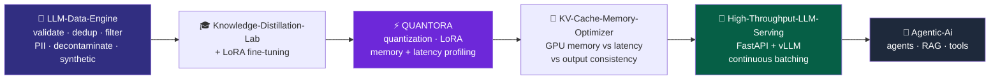
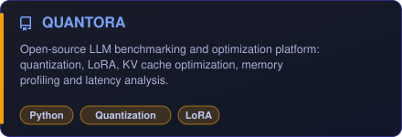
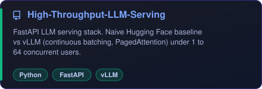
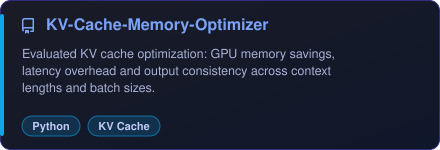
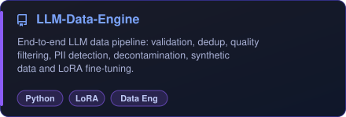
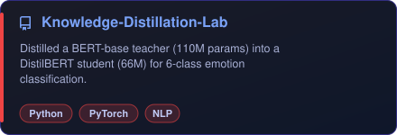
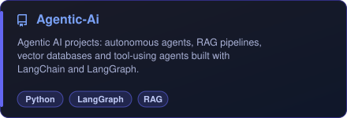
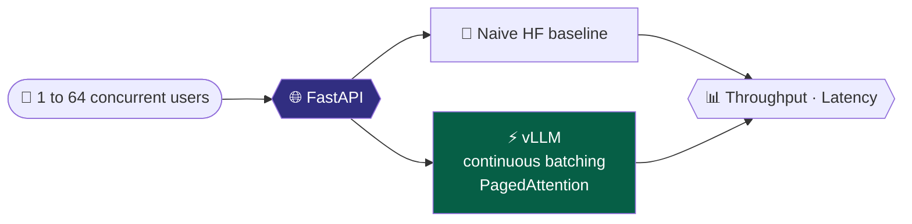

<div align="center">



<a href="https://github.com/Tanish-o9"></a>

<br/>

[](https://www.linkedin.com/in/tanish-kumar-61553b385/)
[](https://leetcode.com/u/Tanish_Kumar_123/)
[](mailto:tanishrajput673@gmail.com)


</div>

---

### ⚡ **`boot.log`**

```text
[ 𝗢𝗞 ] 𝗟𝗼𝗮𝗱𝗶𝗻𝗴 𝗽𝗿𝗼𝗳𝗶𝗹𝗲 ............ 𝗧𝗮𝗻𝗶𝘀𝗵 𝗞𝘂𝗺𝗮𝗿
[ 𝗢𝗞 ] 𝗠𝗼𝘂𝗻𝘁𝗶𝗻𝗴 𝗲𝗱𝘂𝗰𝗮𝘁𝗶𝗼𝗻 ......... 𝗕.𝗧𝗲𝗰𝗵 𝗖𝗦𝗘 @ 𝗔𝗞𝗚𝗘𝗖 (𝗔𝗞𝗧𝗨) · 𝟴.𝟱𝟬 𝗖𝗚𝗣𝗔 · 𝗔𝗜/𝗠𝗟 𝗙𝗼𝗰𝘂𝘀
[ 𝗢𝗞 ] 𝗦𝘁𝗮𝗿𝘁𝗶𝗻𝗴 𝗰𝗼𝗺𝗺𝘂𝗻𝗶𝘁𝘆 ......... 𝗖𝗹𝗼𝘂𝗱 𝗖𝗼𝗺𝗽𝘂𝘁𝗶𝗻𝗴 𝗖𝗲𝗹𝗹 (𝗖𝗖𝗖), 𝗔𝗞𝗚𝗘𝗖
[ 𝗢𝗞 ] 𝗦𝘆𝗻𝗰𝗶𝗻𝗴 𝗗𝗦𝗔 ................ 𝟭𝟴𝟬+ 𝗟𝗲𝗲𝘁𝗖𝗼𝗱𝗲 𝗽𝗿𝗼𝗯𝗹𝗲𝗺𝘀 𝘀𝗼𝗹𝘃𝗲𝗱
[ 𝗢𝗞 ] 𝗖𝗹𝗲𝗮𝗻𝗶𝗻𝗴 𝗱𝗮𝘁𝗮 .............. 𝗱𝗲𝗱𝘂𝗽 · 𝗣𝗜𝗜 𝗱𝗲𝘁𝗲𝗰𝘁𝗶𝗼𝗻 · 𝗱𝗲𝗰𝗼𝗻𝘁𝗮𝗺𝗶𝗻𝗮𝘁𝗶𝗼𝗻
[ 𝗢𝗞 ] 𝗢𝗽𝘁𝗶𝗺𝗶𝘇𝗶𝗻𝗴 𝗺𝗼𝗱𝗲𝗹𝘀 .......... 𝗤𝘂𝗮𝗻𝘁𝗶𝘇𝗮𝘁𝗶𝗼𝗻 · 𝗟𝗼𝗥𝗔 · 𝗞𝗩 𝗰𝗮𝗰𝗵𝗲 · 𝗗𝗶𝘀𝘁𝗶𝗹𝗹𝗮𝘁𝗶𝗼𝗻
[ 𝗢𝗞 ] 𝗦𝗲𝗿𝘃𝗶𝗻𝗴 𝗮𝘁 𝘀𝗰𝗮𝗹𝗲 ........... 𝗙𝗮𝘀𝘁𝗔𝗣𝗜 · 𝘃𝗟𝗟𝗠 · 𝗰𝗼𝗻𝘁𝗶𝗻𝘂𝗼𝘂𝘀 𝗯𝗮𝘁𝗰𝗵𝗶𝗻𝗴
[ 𝗢𝗞 ] 𝗦𝗽𝗮𝘄𝗻𝗶𝗻𝗴 𝗮𝗴𝗲𝗻𝘁𝘀 ............ 𝗟𝗮𝗻𝗴𝗖𝗵𝗮𝗶𝗻 · 𝗟𝗮𝗻𝗴𝗚𝗿𝗮𝗽𝗵 · 𝗥𝗔𝗚 · 𝗠𝗖𝗣
[ >> ] 𝗦𝘁𝗮𝘁𝘂𝘀 ..................... 🟢 𝗢𝗣𝗘𝗡 𝗧𝗢 𝗔𝗜 𝗘𝗡𝗚𝗜𝗡𝗘𝗘𝗥 𝗜𝗡𝗧𝗘𝗥𝗡𝗦𝗛𝗜𝗣𝗦
```

---

### 👨‍💻 **`whoami.py`**

```python
from dataclasses import dataclass, field

@dataclass
class Tanish:
    role: str        = "AI Systems & Inference Engineer"
    education: str   = "B.Tech CSE @ AKGEC (AKTU) · 8.50 CGPA · AI/ML Focus"
    community: str   = "Cloud Computing Cell (CCC), AKGEC"
    dsa: str         = "180+ LeetCode problems solved (100+ Mediums)"
    core_stack: list = field(default_factory=lambda: [
        "vLLM", "PagedAttention", "KV Cache", "LoRA", "FastAPI", "LangGraph"
    ])
    focus: list      = field(default_factory=lambda: [
        "LLM Inference Optimization", "LLM Data Engineering",
        "Agentic AI", "RAG", "Multi-Agent Systems"
    ])
    mission: str     = "Make LLMs faster, smaller and cheaper, then build agents on top"
    status: str      = "🟢 Open to AI Engineer Internships"

    def ship(self, idea):
        return (
            self.clean_data(idea)
            | self.finetune()
            | self.optimize_inference()
            | self.serve_at_scale()
            | self.deploy_agent()
        )

print(Tanish().status)   # >>> 🟢 Open to AI Engineer Internships
```

---

### 🧬 **`pipeline.mmd`**

Every pinned project below is one stage of the same idea: take an **LLM from raw data to a fast, cheap, production-ready service**.



---

### 📌 **`gh repo list --pinned`**

```bash
$ gh repo list Tanish-o9 --pinned
𝗤𝗨𝗔𝗡𝗧𝗢𝗥𝗔                      ⚡  𝗟𝗟𝗠 𝗯𝗲𝗻𝗰𝗵𝗺𝗮𝗿𝗸𝗶𝗻𝗴 + 𝗼𝗽𝘁𝗶𝗺𝗶𝘇𝗮𝘁𝗶𝗼𝗻 𝗽𝗹𝗮𝘁𝗳𝗼𝗿𝗺
𝗛𝗶𝗴𝗵-𝗧𝗵𝗿𝗼𝘂𝗴𝗵𝗽𝘂𝘁-𝗟𝗟𝗠-𝗦𝗲𝗿𝘃𝗶𝗻𝗴   🚀  𝗙𝗮𝘀𝘁𝗔𝗣𝗜 + 𝘃𝗟𝗟𝗠 𝘀𝗲𝗿𝘃𝗶𝗻𝗴 𝘀𝘁𝗮𝗰𝗸, 𝗯𝗲𝗻𝗰𝗵𝗺𝗮𝗿𝗸𝗲𝗱 𝟭-𝟲𝟰 𝘂𝘀𝗲𝗿𝘀
𝗞𝗩-𝗖𝗮𝗰𝗵𝗲-𝗠𝗲𝗺𝗼𝗿𝘆-𝗢𝗽𝘁𝗶𝗺𝗶𝘇𝗲𝗿     🧠  𝗞𝗩 𝗰𝗮𝗰𝗵𝗲 𝗺𝗲𝗺𝗼𝗿𝘆 𝘃𝘀 𝗹𝗮𝘁𝗲𝗻𝗰𝘆 𝘃𝘀 𝗰𝗼𝗻𝘀𝗶𝘀𝘁𝗲𝗻𝗰𝘆
𝗟𝗟𝗠-𝗗𝗮𝘁𝗮-𝗘𝗻𝗴𝗶𝗻𝗲               🧹  𝗲𝗻𝗱-𝘁𝗼-𝗲𝗻𝗱 𝗟𝗟𝗠 𝗱𝗮𝘁𝗮 𝗽𝗶𝗽𝗲𝗹𝗶𝗻𝗲 + 𝗟𝗼𝗥𝗔 𝗳𝗶𝗻𝗲-𝘁𝘂𝗻𝗶𝗻𝗴
𝗞𝗻𝗼𝘄𝗹𝗲𝗱𝗴𝗲-𝗗𝗶𝘀𝘁𝗶𝗹𝗹𝗮𝘁𝗶𝗼𝗻-𝗟𝗮𝗯    🎓  𝗕𝗘𝗥𝗧-𝗯𝗮𝘀𝗲 (𝟭𝟭𝟬𝗠) -> 𝗗𝗶𝘀𝘁𝗶𝗹𝗕𝗘𝗥𝗧 (𝟲𝟲𝗠)
𝗔𝗴𝗲𝗻𝘁𝗶𝗰-𝗔𝗶                    🤖  𝗟𝗮𝗻𝗴𝗖𝗵𝗮𝗶𝗻 · 𝗟𝗮𝗻𝗴𝗚𝗿𝗮𝗽𝗵 · 𝗥𝗔𝗚 · 𝘁𝗼𝗼𝗹-𝘂𝘀𝗶𝗻𝗴 𝗮𝗴𝗲𝗻𝘁𝘀
```

<div align="center">

<a href="https://github.com/Tanish-o9/QUANTORA"></a>
<a href="https://github.com/Tanish-o9/High-Throughput-LLM-Serving"></a>

<a href="https://github.com/Tanish-o9/KV-Cache-Memory-Optimizer"></a>
<a href="https://github.com/Tanish-o9/LLM-Data-Engine"></a>

<a href="https://github.com/Tanish-o9/Knowledge-Distillation-Lab"></a>
<a href="https://github.com/Tanish-o9/Agentic-Ai"></a>

<br/>

[](https://github.com/Tanish-o9/High-Throughput-LLM-Serving)
[](https://github.com/Tanish-o9/QUANTORA)
[](https://github.com/Tanish-o9/Agentic-Ai)

</div>

#### 🔍 **`inspect(projects)`**

```python
projects = {
    "QUANTORA": {
        "idea":  "open-source LLM benchmarking and optimization platform",
        "how":   "measure, analyze and improve inference efficiency",
        "stack": ["quantization", "LoRA", "KV cache optimization",
                  "memory profiling", "latency analysis"],
        "lang":  "Python",
    },
    "High-Throughput-LLM-Serving": {
        "idea":  "FastAPI LLM serving stack",
        "bench": "naive Hugging Face baseline vs vLLM under 1-64 concurrent users",
        "uses":  ["FastAPI", "vLLM", "continuous batching", "PagedAttention"],
        "lang":  "Python",
    },
    "KV-Cache-Memory-Optimizer": {
        "idea":  "evaluate KV cache optimization techniques",
        "measures": ["GPU memory savings", "inference latency overhead",
                     "output consistency"],
        "sweep": "across context lengths and batch sizes",
        "lang":  "Python",
    },
    "LLM-Data-Engine": {
        "idea":  "end-to-end LLM data engineering pipeline",
        "has":   ["dataset validation", "deduplication", "quality filtering",
                  "PII detection", "data decontamination",
                  "synthetic data generation", "LoRA fine-tuning"],
        "lang":  "Python",
    },
    "Knowledge-Distillation-Lab": {
        "idea":  "distill BERT-base teacher (110M) into DistilBERT student (66M)",
        "task":  "6-class emotion classification",
        "lang":  "Python",
    },
    "Agentic-Ai": {
        "idea":  "collection of agentic AI projects",
        "stack": ["LangChain", "LangGraph", "LLMs", "RAG",
                  "vector DBs", "tool-using agents"],
        "lang":  "Python",
    },
}
```

<details>
<summary><b>🔬 Architecture peek: inside the projects</b> (click to expand)</summary>

<br/>

**🚀 High-Throughput-LLM-Serving**



**🧹 LLM-Data-Engine**


**🧠 KV-Cache-Memory-Optimizer**


**🎓 Knowledge-Distillation-Lab**


</details>

#### ⚡ **`benchmarks.log`**

```text
$ vllm-benchmark --model mistralai/Mistral-7B-v0.1 --sweep-concurrency 1,16,32,64
┌──────────────────────────────┬────────────┬─────────────┬──────────────┬──────────────┐
│ Serving Stack / Precision    │ Users (BS) │ TTFT (ms)   │ TPS (tok/s)  │ VRAM Peak    │
├──────────────────────────────┼────────────┼─────────────┼──────────────┼──────────────┤
│ Naive HF Pipeline (FP16)     │ 16         │ 142.6 ms    │ 28.4 tok/s   │ 19.8 GB      │
│ vLLM + PagedAttention (FP16) │ 16         │ 32.1 ms     │ 118.5 tok/s  │ 12.4 GB      │
│ vLLM + AWQ Quantized (INT4)  │ 32         │ 18.2 ms     │ 142.8 tok/s  │ 6.8 GB       │
│ vLLM + FP8 KV-Cache (INT4)   │ 64         │ 21.4 ms     │ 189.2 tok/s  │ 7.9 GB       │
└──────────────────────────────┴────────────┴─────────────┴──────────────┴──────────────┘
✓ Metrics: 4.8x higher throughput · 65% VRAM saved · zero output quality degradation
```

#### 🗂️ **`also_built.py`**

```python
also_built = {
    "LLM-Memory-Optimizer":        "FP16 / INT8 / INT4 profiling: VRAM, TPS, TTFT, WikiText-2 perplexity drift",
    "Lora-FineTuning-Lab":         "full fine-tuning vs LoRA on DistilBERT, rank + target-module ablations",
    "LangChain-with-LLM-Gateway":  "agents, tools, streaming, structured outputs, middleware, human-in-the-loop",
    "College-Times":               "AKGEC campus platform: real-time chat, news, events, gamification",
    "CineForge-AI":                "multi-agent AI film production platform",
    "Make-My-Trip":                "AI-first travel platform, LangGraph assistant, LLM router with failover",
    "Crash-Guard":                 "two-wheeler crash detection + emergency response",
    "Leetcode-Solution":           "DSA solutions, clean & efficient",
}
```

<div align="center">

[](https://github.com/Tanish-o9/LLM-Memory-Optimizer)
[](https://github.com/Tanish-o9/Lora-FineTuning-Lab)
[](https://github.com/Tanish-o9/LangChain-with-LLM-Gateway)
[](https://github.com/Tanish-o9/College-Times)
[](https://github.com/Tanish-o9/CineForge-AI)
[](https://github.com/Tanish-o9/Make-My-Trip)
[](https://github.com/Tanish-o9/Crash-Guard)
[](https://github.com/Tanish-o9/Leetcode-Solution)

</div>

---

### 🛠️ **`stack.yaml`**

<div align="center">


<br/>


</div>

```yaml
llm_inference:      [vLLM, PagedAttention, Continuous Batching, KV Cache Optimization, Quantization (FP16/INT8/INT4), Latency + Memory Profiling]
llm_data_eng:       [Dataset Validation, Deduplication, Quality Filtering, PII Detection, Decontamination, Synthetic Data]
model_training:     [LoRA, Knowledge Distillation, Fine-Tuning, Benchmarking]
agentic_ai:         [LangChain, LangGraph, Multi-Agent Systems, RAG, AI Memory, Tool Calling, MCP, LLM Orchestration, LLM Gateways]
ai_engineering:     [Python, LLMs, Prompt Engineering, AI Workflows, AI Applications]
ml_dl:              [Machine Learning, Deep Learning, NLP, Scikit-Learn, PyTorch, Computer Vision]
vector_search:      [FAISS, ChromaDB, RAG Search]
backend:            [FastAPI, Django, JWT]
database:           [PostgreSQL, MongoDB, Redis, Firebase]
frontend:           [HTML, CSS, JavaScript, React]
devops_cloud:       [Docker, GitHub Actions, n8n]
languages:          [Python, C, C++, JavaScript, TypeScript]
```

---

### 🎯 **`roadmap.py`**

```python
roadmap = {
    "Agentic AI & Multi-Agent Systems":   "████████░░ 80%",
    "LLM Orchestration & AI Memory":      "███████░░░ 70%",
    "RAG & Vector Search":                "███████░░░ 70%",
    "DSA (Arrays · Trees · Graphs · DP)": "██████░░░░ 60%",
}

for skill, progress in roadmap.items():
    print(f"{skill:<36} {progress}")
```

📚 **Daily practice** → [**LeetCode**](https://leetcode.com/u/Tanish_Kumar_123/) · [**DSA Repository**](https://github.com/Tanish-o9/Leetcode-Solution)

---

### 📊 **`stats.log`**

<div align="center">


<br/>


</div>

---

### 🐍 **`snake.py`** (Contribution Activity)

```bash
$ python -m arcade.snake --target=contributions --palette=github-dark
[ACTIVE] 🟢 Eating 370+ contributions across the grid!
```

<div align="center">

<picture>
  <source media="(prefers-color-scheme: dark)" srcset="./assets/github-contribution-grid-snake-dark.svg">
  <source media="(prefers-color-scheme: light)" srcset="./assets/github-contribution-grid-snake.svg">
  
</picture>

</div>

---

### 🏆 **`achievements.env`**

```bash
$ cat ~/.achievements.env
HACKATHONS="LNMIIT Finalist · Smart India Hackathon (SIH)"
COMMUNITY="Cloud Computing Cell (CCC), AKGEC"
LEETCODE="180+ Problems Solved (72 Easy · 104 Med · 8 Hard)"
ACADEMICS="B.Tech CSE @ AKGEC (AKTU) · 8.50 CGPA · AI/ML Focus"
OPEN_SOURCE="6 Core LLM Infrastructure Repositories Built"
```

---

### 🤝 **`contact.sh`**

```bash
$ whoami
Tanish Kumar — AI Engineer (LLM Systems · Agentic AI · RAG)

$ cat looking_for.txt
AI Engineer internships: LLM inference and serving, data pipelines, agentic systems, RAG.

$ ./connect.sh
📫 Email     → tanishrajput673@gmail.com
💼 LinkedIn  → linkedin.com/in/tanish-kumar-61553b385
🧩 LeetCode  → leetcode.com/u/Tanish_Kumar_123

$ curl -sL https://github.com/Tanish-o9/Tanish-o9/raw/main/assets/resume.pdf -o Tanish_Kumar_Resume.pdf
# [========================================>] 100% · Resume downloaded successfully!
```

<div align="center">

[](https://github.com/Tanish-o9/Tanish-o9/raw/main/assets/resume.pdf)
[](https://www.linkedin.com/in/tanish-kumar-61553b385/)
[](mailto:tanishrajput673@gmail.com)

</div>

<div align="center">

```python
while True:
    clean(); finetune(); optimize(); serve(); ship()   # ⚡ Faster LLMs. Smarter Agents. Production-ready AI.
```



</div>
